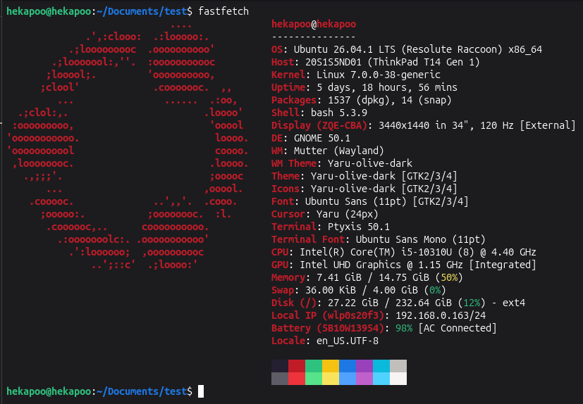

# Linux
### 1. [Change file permissions](#change-file-permissions)
```r - readable```
```w - writeable```
```x - executable```

```bash
$ chmod +x/+r+/+w/-x/-w/-r <file-path>
```
Most common use is to make a shell file executable:
```bash
$ chmod +x <file-path>
```

### 2. [Grep for processes](#grep-for-processes)
Can use ```man ps``` for more details on the command.
```bash
$ ps -ef | grep program_name_or_string
```

### 3. [Fastfetch](#fastfetch)
Alternative to the old deprecated ```neofetch```. Install via:
```bash
$ sudo apt install neofetch
```
<details>
<summary> Open for showcase </summary>

</details>